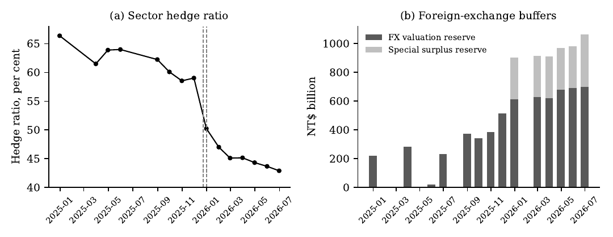

# Accounting Rules, Currency Hedging and External Adjustment

Data and code for the empirical evidence in

> Aslan, I. (2026). Accounting rules, currency hedging and external adjustment: Evidence from Taiwan's life insurers. Working paper. [ilkeraslan.github.io](https://ilkeraslan.github.io/papers/currency-hedging-taiwan-life-insurers.html)



Taiwan's current-account surplus reached 19.6 per cent of GDP in 2025, and its life insurers are the main channel through which it is invested abroad. Whether they hedge determines how much of the surplus reaches the spot market and who bears the currency risk. The paper studies an accounting change, effective in January 2026, that lets insurers amortise exchange differences on foreign bonds held at amortised cost over the bonds' remaining lives. In a model in which insurers penalise the variance of both economic and reported earnings, the response of the hedge ratio identifies the share of hedging done to protect reported earnings.

## Main results

- The sector's hedge ratio fell from 59 to 43 per cent between November 2025 and June 2026, about NT$2.4 trillion of hedges or two-fifths of the 2025 surplus. At least 30 per cent of prior hedging served reported earnings.
- The Taiwan dollar weakened by 0.5 to 0.7 per cent against regional currencies on the two most informative announcements (Table 4).
- Singapore Exchange futures show the dollar's three-month forward discount against the Taiwan dollar closing from 3.6 per cent on the eve of the industry's proposal to zero at the end of December 2025, while the comparison currencies moved by 0.6 points (Figure 2, Table 6).
- Interbank turnover in outright forwards fell by 38 per cent from January 2026 (t = 8.8); swap turnover did not change (Table 7).
- Share prices of insurance-heavy financial groups show no announcement gain (Table 9).

## Files

| File | Content |
|---|---|
| `code/common.py` | Shared settings: sample, announcement dates, FRED access, the event-study and randomisation-inference routine |
| `code/spot_event_study.py` | Spot response of the Taiwan dollar against the Korean won and the Singapore dollar (Table 4); `--download` refreshes the FRED series and adds the check against windows from 2019 |
| `code/equity_event_study.py` | Share-price event study, insurance-heavy against bank-centred financial groups (Table 9); downloads prices from Yahoo Finance |
| `code/futures_event_study.py` | Forward discount implied by Singapore Exchange currency futures (Figure 2, Table 6); `--history` builds the longer comparison sample from 2020 |
| `code/turnover.py` | Turnover in the Taipei foreign-exchange market by instrument (Table 7) |
| `code/make_figure.py` | Figure 1 |
| `code/run_all.py` | Runs every step |
| `results/` | Tables (`results_*.tex`), estimates (`*_results.json`), the forward-discount series and Figures 1 and 2 |

## Data

| File | Source |
|---|---|
| `data/twd_*.csv`, `krw_*.csv`, `sgd_*.csv`, `fred_spot_2019_2026.csv` | Federal Reserve H.10 noon buying rates (DEXTAUS, DEXKOUS, DEXSIUS), via FRED |
| `data/fsc_monthly.csv` | Monthly statistics of Taiwan's Financial Supervisory Commission on the life insurers' hedge ratio, buffers and hedging costs, with a source for each observation |
| `data/cbc_fx_turnover.csv` | Central Bank of the Republic of China (Taiwan), monthly releases on the Taipei foreign exchange market, January 2025 to September 2026 |
| `data/cbc_swap_balance.csv` | The central bank's outstanding US-dollar/Taiwan-dollar swaps |

The Singapore Exchange settlement files and the Yahoo Finance share prices are not redistributed. `futures_event_study.py` downloads the exchange's daily files (about 260 for the main sample) and caches the extracted currency futures in `data/sgx_fx_futures.csv`; `equity_event_study.py` downloads the share prices with `yfinance`.

## Running the code

```
python -m pip install -r requirements.txt
python code/run_all.py
```

The spot, turnover and figure scripts run from the files in `data/`. The futures and share-price scripts need internet access the first time. With the same data the scripts reproduce the files in `results/` exactly. They were last checked with Python 3.13, pandas 3.0, NumPy 2.5 and Matplotlib 3.11.

## Citation

Please cite the paper. GitHub's "Cite this repository" button gives the reference in APA and BibTeX formats.

## Licence

Code: MIT licence (see `LICENSE`). The data in `data/` are from the public sources listed above.

## Author

Ilker Aslan, Lecturer, Kalaidos University of Applied Sciences, Zürich
[ORCID 0000-0001-9241-9420](https://orcid.org/0000-0001-9241-9420) · [ilkeraslan.github.io](https://ilkeraslan.github.io)
